# Test Driven Development
This repository contains code for reading carbon emission and GDP data, aligning it by year, and creating scatter plots of the data. You can use it to examine relationships between GDP and different sources of emissions for various countries.

## Installation and set up
First, open your Terminal and navigate to the directory that you want this repository to be located in. Then clone the repository by running
```
git clone https://github.com/maiakrd98/test-driven-development.git
```

Next, navigate to the `test-driven-development` folder by running 
```
cd test-driven-development
```

Here, you will see all the files in the repository.

To set up the environment, first run this code to create the environment:
```
mamba env create -f environment.yml
```
Then activate the environment by running
```
mamba activate swe4s
```

This environment contains `pycodestyle` for checking that python code is compliant with the PEP 8 style guide, `wget` for running the functional test file, `matplotlib` and `graphviz` for plotting, and `snakemake` for workflow management.

Next, run
```
curl -L "https://docs.google.com/uc?export=download&id=1AsXP_OGs1O_TDeXiZjk3fYV1SrG4vwXF" -o data/Agrofood_co2_emission.csv
curl -L "https://docs.google.com/uc?export=download&id=19YEPysdnK7VCXuAe9Og9pwYkNT5CbQzr" -o data/IMF_GDP.csv
```
to import the required data files (which are not committed to the repository because they are too big).

## Data file information
`Agrofood_co2_emission.csv` is a comma separated file with countries listed in the first column, years listed in the second column, and corresponding greenhouse gas emmissions from various sources listed in the remaining columns. It should be located in the `data` directory (which the commands above should automatically take care of). `IMF_GDP.csv` should also be located in the `data` directory and is a comma separated file with countries in the first column and their GDPs in the years between 1950 and 2022 in the remaining columns. Both files have some blank entries, which indicate missing data for that country and year.

This repository also contains two small data files called `Agrofood_co2_emission_test.csv` and `IMF_GDP_test.csv` in `test/data` that are smaller versions of `Agrofood_co2_emission.csv` and `IMF_GDP.csv` and are used in testing.

## Code function and testing instructions

`fire_gdp.py` contains three functions:
- `get_data(file_name, query_column=None, query_value=None, return_header=False)` returns rows from a data file as strings. If a query column and value are given, it returns only the rows where the string in that column matches the value. If `return_header` is `True`, it also return the header.
- `get_column_index(header, column_name)` returns the position of a column name in a header list. If the name is not in the header, it returns `None`.
- `get_fire_gdp_year_data(co2_file, gdp_file, country, emission_col_name="Forest fires")` combines emissions and GDP for one country by matching years and returns a list of `[year, emissions, gdp]` entries. If `emission_col_name` is provided, it returns that emission type, otherwise it returns forest fire emissions.

To run the unit tests to check that these functions are working correctly, run the following command from the main directory of the repository
```
python -m unittest discover -s test/unit
```

`plot_fire_gdp.py` takes seven command line arguments: `--co2_file`, `--gdp_file`, `--out_file`, `--title`, `--y_variable`, `--y_axis_label`, and `--country`. Using the functions in `fire_gdp.py` and data from `co2_file` and `gdp_file`, this file creates a scatterplot of GDP on the x-axis vs `y_variable` (which should be a header of `co2_file`) on the y-axis for the given `country`. The plot is titled `title` and the y-axis is labeled with `y_axis_label`. The plot is saved to the path given in `out_file`.

Examples of running `plot_fire_gdp.py` are in the following section.

To run the functional tests, which check that `plot_fire_gdp.py` is working, run the following command from the main directory of the repository
```
bash test/func/test_fire_gdp.sh
```

These tests also run automatically as a github action anytime you push to the remote repository or submit a pull request. This is controlled through the `test.yml` file in the `.github/workflows` directory.

`Snakefile` specifies a workflow to automatically run the required code to produce plots for the desired countries. You can run this file by running the following command from the main directory of the repository:
```
snakemake -c 1
```
This will run `src/plot_fire_gdp.py` with necessary inputs to produce all the plots in the following section. Note that `-c 1` just specifies the number of cores to use, so you could run it with more cores (e.g. `-c 4`) if you want.

## Exploring the relationship between GDP and emissions

### Introduction
We will analyze the relationship between a country's gross domestic product (GDP) and its total carbon emissions by year. Since each country's GDP is in a different currency, they are not directly comparable, so we will examine several countries individually. I hypothesize that GDP and total carbon emissions will have a positive relationship, especially for lower-income countries whose economies (at least in some cases) are growing partly by becoming more industrialized and releasing more emissions. We will look at Brazil, Canada, China, Gabon, Honduras, India, Afghanistan, Algeria, Angola, Argentina, Australia, Bangladesh, Botswana, Egypt, Sweden, Spain, Japan, Kenya, Malawi, Mexico, Peru, Thailand, and Zambia. 

### Results

Some countries have a clear positive relationship between GDP and total carbon emissions. These include Afghanistan, Algeria, Bangladesh, China, Honduras, India, Malawi, Peru, and Thailand, (see below for plots). In some of these countries (Bangladesh and China), the trend appears to level off, but overall, the relationship between GDP and carbon emissions in these countries is consistent with our hypothesis. 

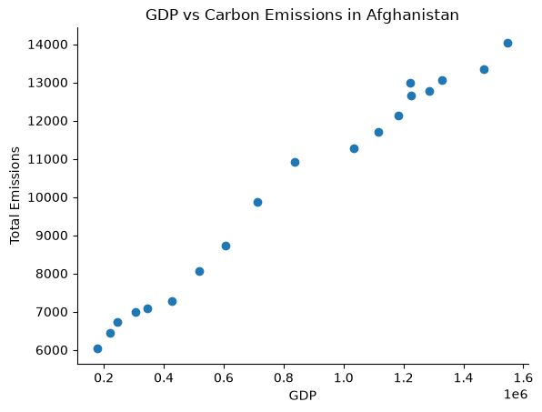
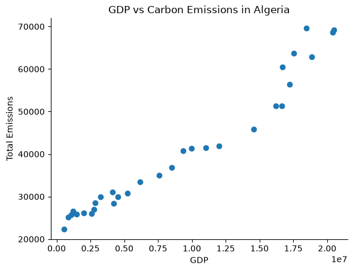
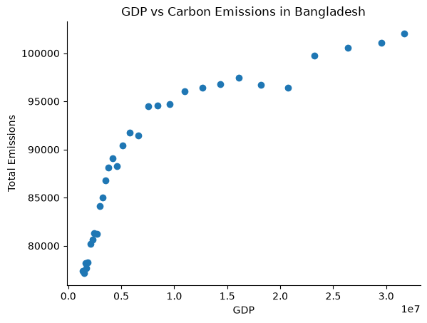
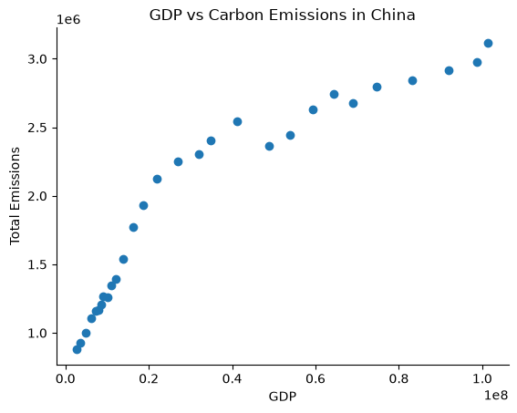
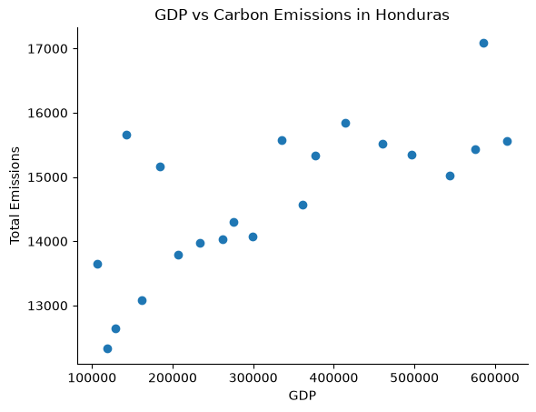
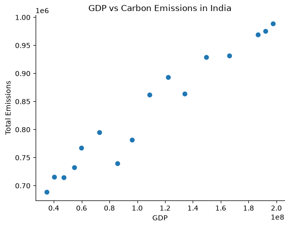
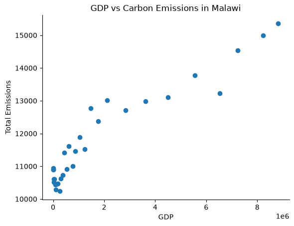
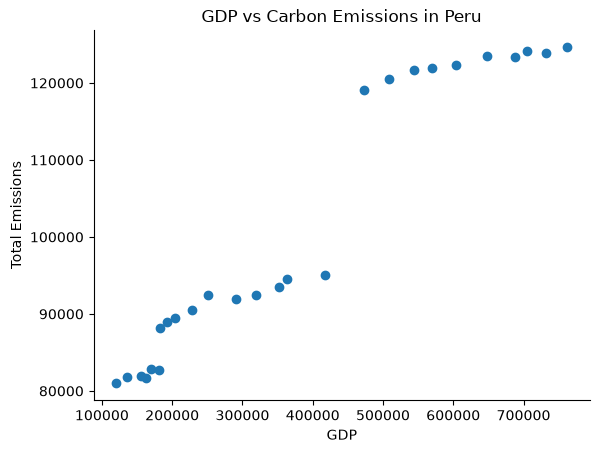
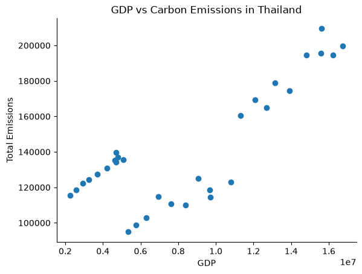

In Egypt, there is a steep positive relationship between GDP and emissions at lower GDP values, but that relationship completely disappears at higher GDP values, where the line is almost completely flat. This is somewhat consistent with our hypothesis, but indicates that the situation is more complicated - some countries may reach a threshold where they no longer require higher emissions to increase their GDP.

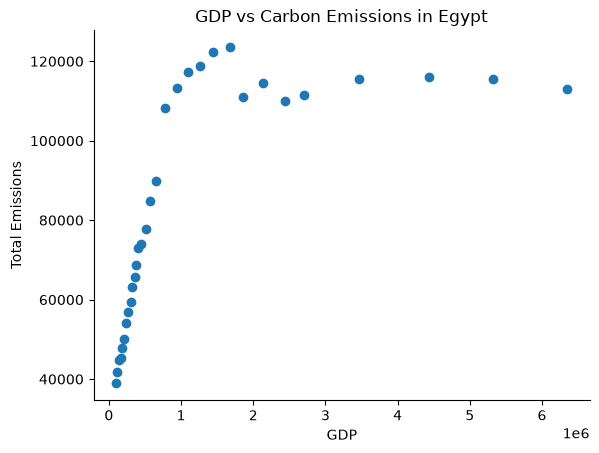

In Spain and to a lesser extent Zambia display a pattern in which emissions at first rise as GDP increases, but then start to drop at larger GDP values. This also complicates our hypothesis.

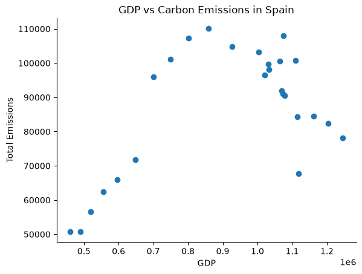
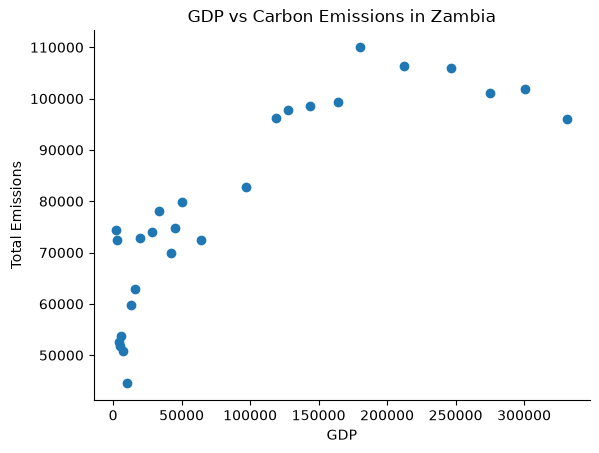

Some countries, including Argentina, Australia, and Sweden, have a negative relationship between GDP and carbon emissions, which is not consistent with our hypothesis.

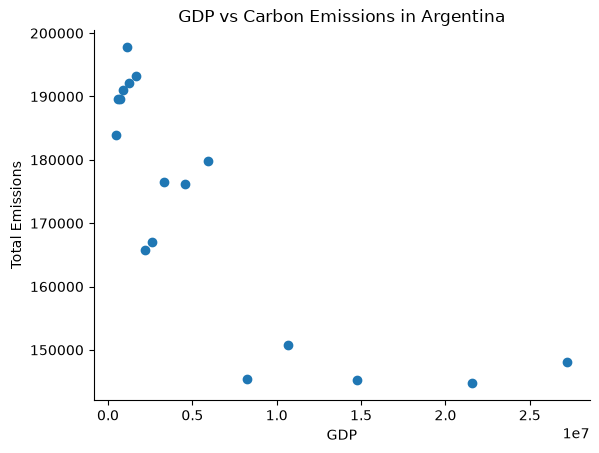
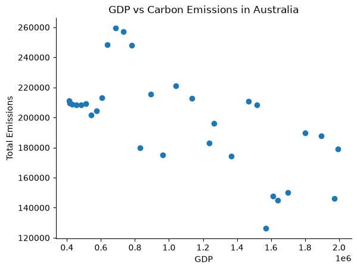
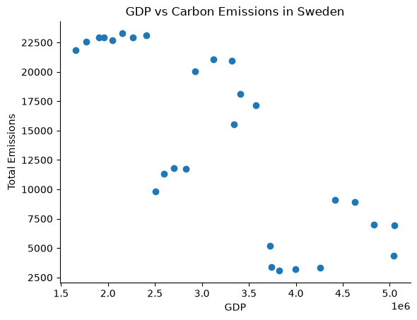

In Angola, Japan, and Botswana, there is no clear relationship between GDP and carbon emissions, which doesn't support our hypothesis.

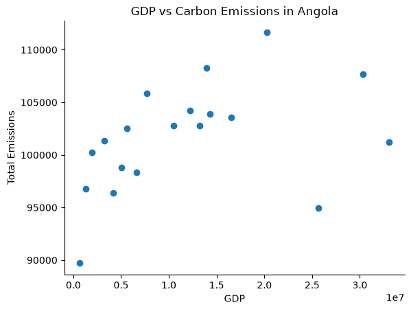
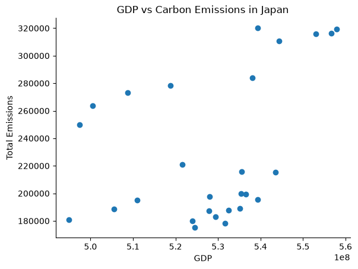
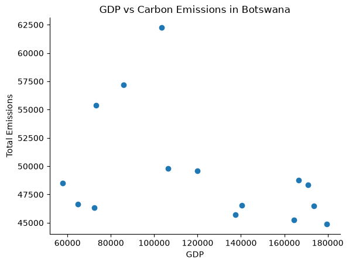

In some countries (Brazil, Canada, Gabon, Kenya, and Mexico), there appears to be an odd stepwise relationship between GDP and carbon emissions where there are different clusters of data points and within each cluster the emissions are roughly flat (or increasing in Mexico's case). I'm not sure what could be causing this, but one possibility is that the way that emissions were measured in those countries changed several times and caused large jumps (both up and down) in the reported emissions.

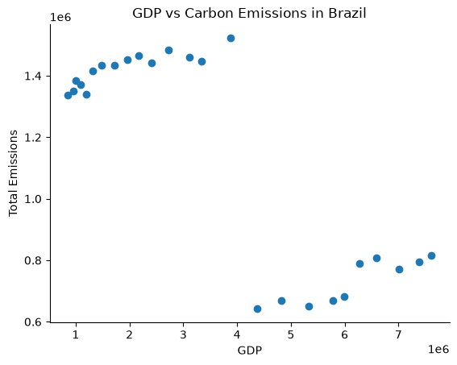
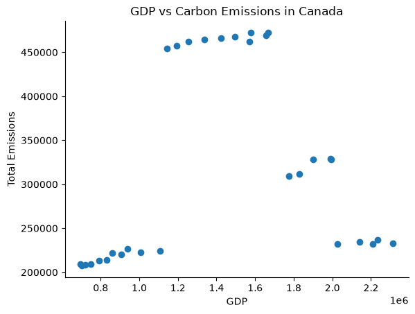
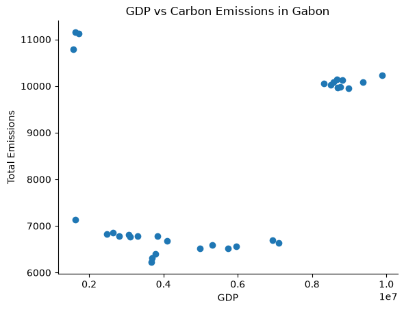
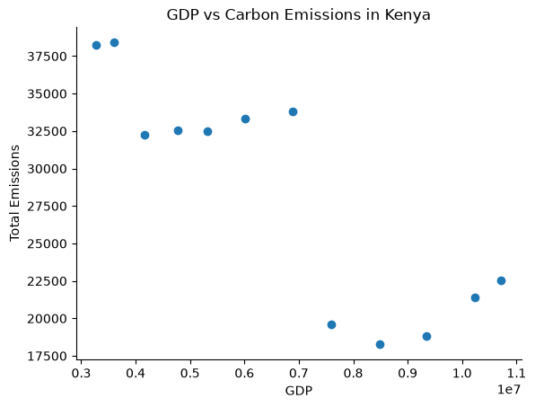
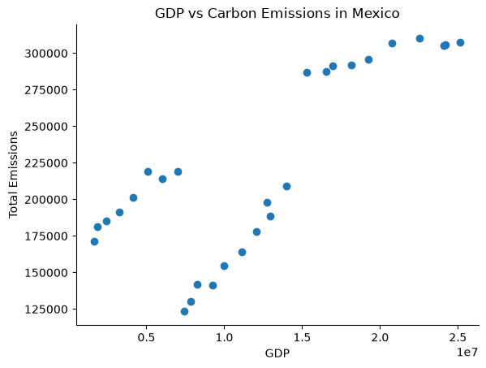

Overall, our hypothesis has some support, but the situation is certainly more complicated than a straightforward positive relationship between GDP and carbon emissions. 

### Methods

To analyze the data, I aligned GDP and total emission data by year and created scatter plots of that data using `src/plot_fire_gdp.py`. To create all plots using the snakemake workflow manager, run

```
snakemake -c 1
```

You can also create plots individually by running `src/plot_fire_gdp.py` directly, for example:

Canada:
```
python src/plot_fire_gdp.py \
    --co2_file 'data/Agrofood_co2_emission.csv' \
    --gdp_file 'data/IMF_GDP.csv' \
    --out_file 'plots/Canada_GDP_emissions.png' \
    --title 'GDP vs Carbon Emissions in Canada' \
    --y_axis_label 'Total Emissions' \
    --y_variable 'total_emission' \
    --country 'Canada'
```

Brazil:
```
python src/plot_fire_gdp.py \
    --co2_file 'data/Agrofood_co2_emission.csv' \
    --gdp_file 'data/IMF_GDP.csv' \
    --out_file 'plots/Brazil_GDP_emissions.png' \
    --title 'GDP vs Carbon Emissions in Brazil' \
    --y_axis_label 'Total Emissions' \
    --y_variable 'total_emission' \
    --country 'Brazil'
```

## Testing snakemake workflow
To test the snakemake workflow, we could check that the correct files are produced using a method similar to the functional tests. In this case, that would be the files `plots/Afghanistan_GDP_emissions.png`, ..., `plots/Zambia_GDP_emissions.png`. We could also check that no additional files are created. Also, we could test that the expected python scripts were run, although I'm not sure how to do that. In this scenario, I don't know of a way to check that the contents of the plots are correct, but for a different snakemake workflow that produced csvs or other file types, we could check that the contents were right.

## Update history

### v1.0
- Initial project
- Implemented `get_data`, `get_column_index`, and `get_fire_gdp_year_data` functions
- Wrote `plot_fire_gdp.py` to create scatter plots of GDP vs carbon emissions
- Unit and functional tests
- Plotted and analyzed relationship between GDP and total carbon emissions for eight countries

### v2.0
- Added `Snakefile` to manage workflow and automatically run necessary code to create scatter plots
- Plotted and analyzed relationship between GDP and total carbon emissions for 23 countries
